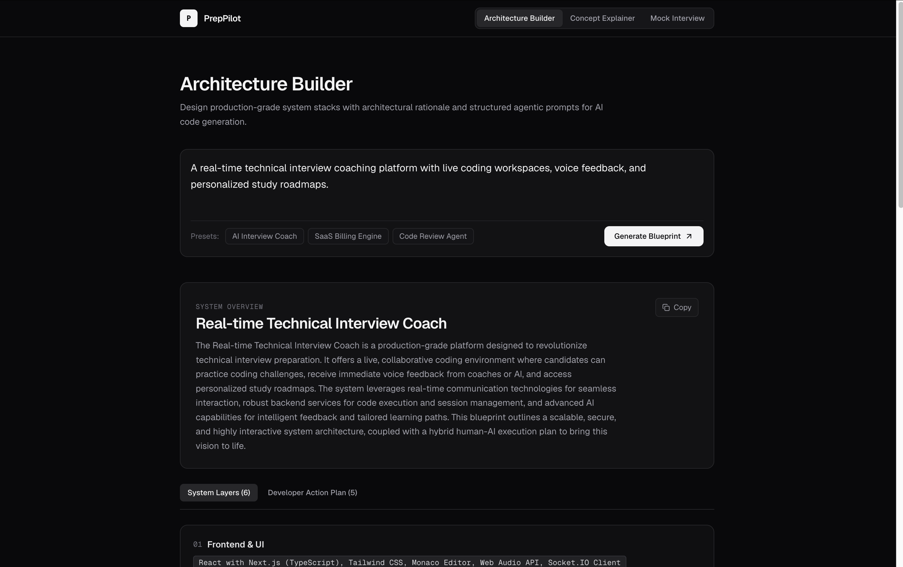
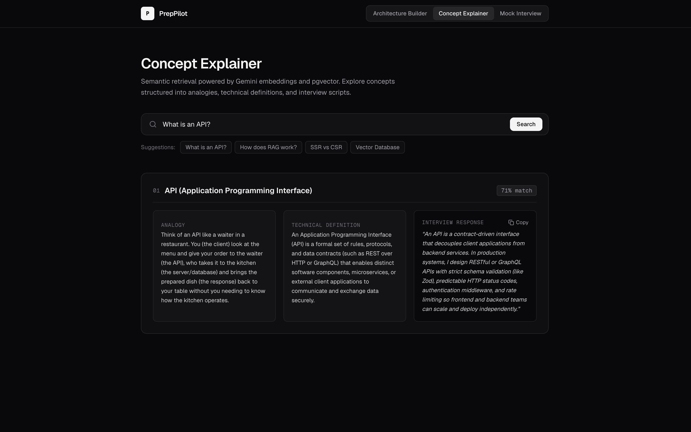
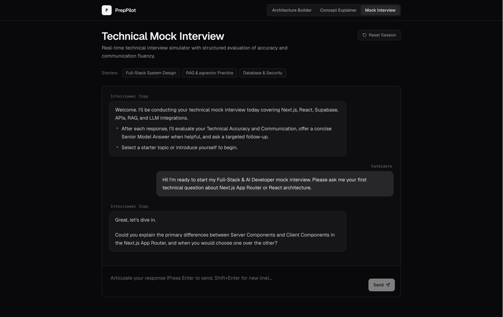

# 🚀 PrepPilot AI

> **An Agentic Full-Stack Platform for Generating Production Architecture Blueprints, Interview Justifications ("Why"), and Human vs. AI Task Allocations.**

[](https://preppilot-ai-eight.vercel.app/)
[](https://github.com/kaung-myat-code/preppilot-ai/actions/workflows/ci.yml)
[](https://nextjs.org/)
[](https://www.typescriptlang.org/)
[](https://tailwindcss.com/)
[](https://supabase.com/)
[](https://aistudio.google.com/)
[](https://opensource.org/licenses/MIT)

---

## 🖼️ Application Preview & Screenshots

🔗 **Live demo:** [https://preppilot-ai-eight.vercel.app/](https://preppilot-ai-eight.vercel.app/)

### Blueprint Builder


### Concept Explainer


### Mock Interview


---

## 📌 Problem & Motivation

Fresh Computer Science and Information Technology graduates frequently encounter common bottlenecks when transitioning into the industry:
1. **The "Why" Gap in Interviews:** Junior developers often struggle to explain *why* a specific architecture or technology was selected over alternatives under interview conditions.
2. **AI Dependency vs. Human Ownership:** With the rise of AI coding agents, developers frequently fall into copy-paste habits without internalizing core system design, data flows, and security boundaries.
3. **Tutorial Hell & Unstructured Roadmaps:** Lacking clear, production-grade blueprints that divide human engineering decisions from machine boilerplate.

**PrepPilot AI** bridges this gap by automatically converting software concepts into comprehensive system designs, interview-ready architectural rationales, and executable agentic prompts.

---

## ✨ Core Features

* **🧠 AI Co-Builder & Blueprint Engine:** Converts rough product concepts into structured system architecture layers (Frontend, Backend, AI Integration, DevOps).
* **💡 Architectural Rationale ("Why" Generator):** Provides clear, defensible justifications for each technology choice with one-click **"Copy for Interview"** snippets.
* **🤖 Agentic Task Separation:** Cleanly divides work modules into **Human Tasks** (architecture, security, verification) and **Agentic AI Prompts** (Cursor / Claude Code boilerplate generation).
* **⚡ High-Throughput Structured Output:** Uses Vercel AI SDK paired with Google Gemini 2.5 Flash and Zod schemas for type-safe JSON output.
* **🔍 Concept Explainer & RAG Module:** Vector semantic search powered by `pgvector` in Supabase for mastering technical terms (LLMs, APIs, Microservices).
* **🎙️ AI Technical Mock Interviewer (Roadmap):** Real-time streaming interview sessions evaluating technical accuracy and English delivery.

---

## 🏗️ System Architecture

```text
┌────────────────────────────────────────────────────────────────────────┐
│                        PREPPILOT AI ARCHITECTURE                       │
├───────────────────┬────────────────────────────┬───────────────────────┤
│ Frontend (Next.js)│     Backend & Storage      │      AI Services      │
├───────────────────┼────────────────────────────┼───────────────────────┤
│ • App Router      │ • Next.js Route Handlers   │ • Gemini 2.5 Flash    │
│ • Tailwind CSS    │ • Supabase SSR Client      │ • Vercel AI SDK (Zod) │
│ • Shadcn UI       │ • PostgreSQL + pgvector    │ • Structured Outputs  │
│ • Lucide Icons    │ • Row Level Security (RLS) │ • Agentic Prompts     │
└───────────────────┴────────────────────────────┴───────────────────────┘
```

---

## 🛠️ Tech Stack

* **Framework:** Next.js 14+ (App Router, React Server Components, Server Actions)
* **Language:** TypeScript
* **Styling:** Tailwind CSS, Lucide React
* **AI & LLM Services:** Google Gemini 2.5 Flash via `@ai-sdk/google` and `ai` (Vercel AI SDK)
* **Database & Auth:** Supabase (PostgreSQL, Supabase Auth, Row Level Security, `pgvector`)
* **Validation:** Zod Schema Validation
* **DevOps & CI/CD:** GitHub Actions, Vercel

---

## 🚀 Getting Started

### 1. Prerequisites
* Node.js v18.17+ or v20+
* Free Google AI Studio API Key ([Google AI Studio](https://aistudio.google.com/))
* Free Supabase Account ([Supabase](https://supabase.com/))

### 2. Installation
```bash
# Clone the repository
git clone https://github.com/kaung-myat-code/preppilot-ai.git
cd preppilot-ai

# Install dependencies
npm install
```

### 3. Environment Variables Setup
Create a `.env.local` file in the root directory:
```env
# Supabase Configuration
NEXT_PUBLIC_SUPABASE_URL=your_supabase_project_url
NEXT_PUBLIC_SUPABASE_ANON_KEY=your_supabase_anon_key

# Google Gemini API Configuration
GOOGLE_GENERATIVE_AI_API_KEY=your_gemini_api_key
```

### 4. Run the Development Server
```bash
npm run dev
```
Open [http://localhost:3000](http://localhost:3000) in your browser.

---

## 🗺️ Roadmap & Milestones

- [x] **Phase 1:** Environment setup, Next.js 14 App Router, Supabase Schema & Auth configuration
- [x] **Phase 2:** AI Co-Builder with Structured Zod Schema, Architectural Rationales, and Gemini 2.5 Flash integration
- [x] **Phase 3:** RAG-powered Tech Concept Explainer with Supabase `pgvector`
- [x] **Phase 4:** AI Technical Mock Interview Engine with streaming feedback
- [ ] **Phase 5:** GitHub Actions CI/CD Pipeline, Vitest Unit Testing, and Production Deployment

---

## 📄 License
This project is licensed under the MIT License.